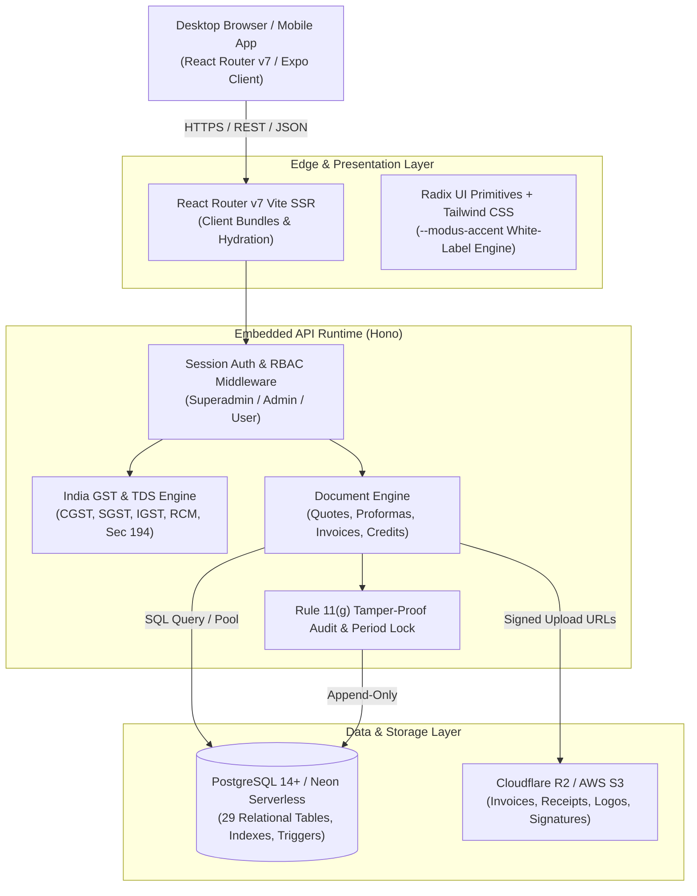

# MODUS ERP — Architecture & Technical Specifications

This document outlines the software architecture, data design, tax computation pipeline, and security mechanisms powering **MODUS ERP**.

---

## System Overview

MODUS is designed as a modular, full-stack ERP tailored for digital studios, agencies, and service enterprises. It prioritizes sub-second page transitions, statutory compliance accuracy, and multi-tenant white-label flexibility.

---

## Relational Data Model

MODUS is backed by 29 normalized PostgreSQL tables with strict referential integrity (`ON DELETE RESTRICT` for financial documents) to preserve historical accounting ledgers.

### Core Schema Domains:

1. **Authentication & Identity**:
   - `users`: Credentials, salt-hashed passwords, role (`superadmin`, `admin`, `user`), avatar keys, session metadata.
   - `password_reset_tokens`: Cryptographic one-time tokens with expiration and single-use enforcement.

2. **Company Profile & White-Label**:
   - `company_settings`: Legal entity details, GSTIN, PAN, bank accounts, UPI identifiers, dynamic brand colors (`brand_color`, `brand_color_dark`), custom logos, app name, and tagline.

3. **Customer & Vendor Directories**:
   - `customers`: Client profiles, registered state codes, GST treatment (`registered_business`, `unregistered_buyer`, `overseas_export`, `sez_developer`, `sez_unit`), payment terms.
   - `vendors`: Supplier profiles, MSME classifications, bank accounts, default TDS tax sections.
   - `client_folders`: Folder hierarchies for project classification.
   - `projects`: Project scopes, budgets, linked customer entities.

4. **Receivables Pipeline**:
   - `quotes`: Presales estimates and formal proposals with revision tracking.
   - `proforma_invoices`: Advance proformas before delivery of services.
   - `invoices`: Statutory tax invoices with financial year numbering (`MODUS/YYYY-YY/NNN`).
   - `invoice_items`: Line items with SAC/HSN codes, quantity, unit rates, and GST percentage rates.
   - `payments`: Realized client collections with TDS withholding deductions and bank ledger references.
   - `credit_notes`: Section 34 compliant credit adjustments and customer refunds.

5. **Payables Pipeline**:
   - `bills`: Accounts Payable records with vendor GSTIN validation and OCR extraction.
   - `bill_items`: Itemized expense allocations with ITC (Input Tax Credit) eligibility tags (`eligible`, `ineligible_17_5`, `ineligible_others`).
   - `bill_payments`: Outgoing disbursements to vendors and contractors.

6. **Statutory Compliance & Audit**:
   - `period_locks`: Accounting period cutoff dates. Documents on or before the lock date cannot be mutated.
   - `audit_logs`: Ministry of Corporate Affairs (MCA) Rule 11(g) compliant tamper-proof edit logs capturing user IDs, timestamps, and before/after JSON diffs.

---

## Indian GST Engine & Tax Pipeline

MODUS implements an automated tax resolution pipeline:

1. **Place of Supply (POS) Derivation**:
   - Compares the company's state code (e.g., `27 - Maharashtra`) against the recipient's state code.
   - **Intra-State**: `POS == Origin` $\rightarrow$ Tax split into equal parts: $CGST = Rate / 2$, $SGST = Rate / 2$.
   - **Inter-State**: `POS != Origin` $\rightarrow$ Tax levied as $IGST = Rate$.
   - **Overseas Export**: Zero-rated ($IGST = 0\%$) under Letter of Undertaking (LUT) or with payment of IGST.
   - **Special Economic Zones (SEZ)**: Treated as inter-state supply, zero-rated under LUT.

2. **Reverse Charge Mechanism (RCM)**:
   - Evaluates vendor status and service type (e.g., legal counsel, import of services). Tax liability shifts to the recipient with automatic RCM debit generation.

3. **GSTR Portal JSON Formats**:
   - Directly serializes to official Goods and Services Tax Network (GSTN) offline tool schemas:
     - **GSTR-1**: Tables `b2b`, `b2cl`, `b2cs`, `exp`, `cdnr`, and `hsn`.
     - **GSTR-3B**: Outward taxable supplies (3.1.a), zero-rated supplies (3.1.b), other outward supplies (3.1.c), inward supplies liable to reverse charge (3.1.d), and net Input Tax Credit available (Table 4).

---

## Security Architecture

- **Statutory Audit Trail (Rule 11(g))**: Every write, update, or status change writes an immutable log row to `audit_logs` storing previous values and updated values as JSON diffs.
- **Period Locks**: Prevents backdating or modifying historical records after tax returns are submitted.
- **Session Security**: Cryptographically signed cookie sessions with HTTP-only, SameSite attributes.
- **CSRF & Rate Limiting**: Hono secure-headers middleware with content security policies and route guards.
